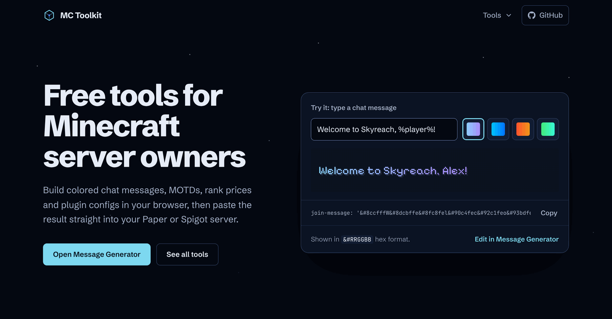
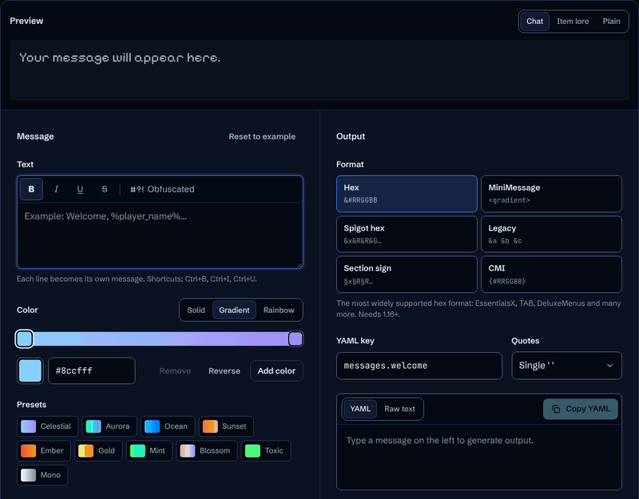
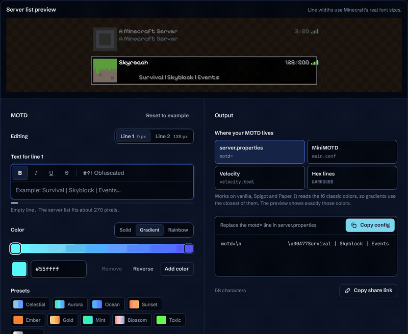
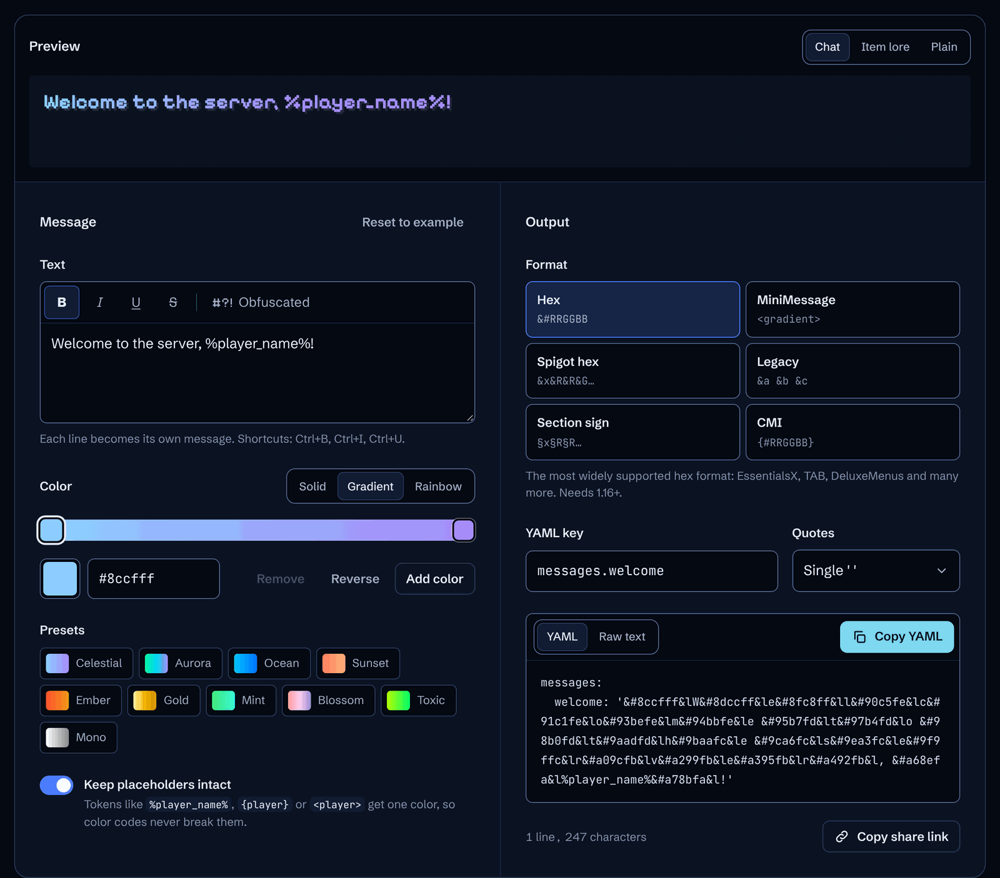
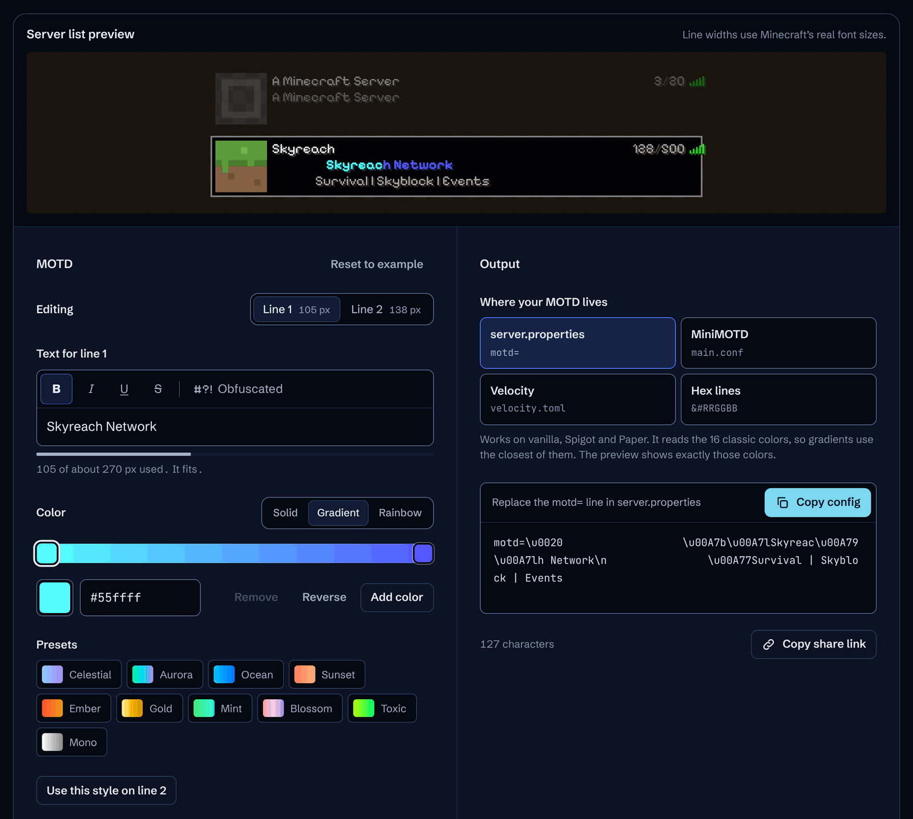
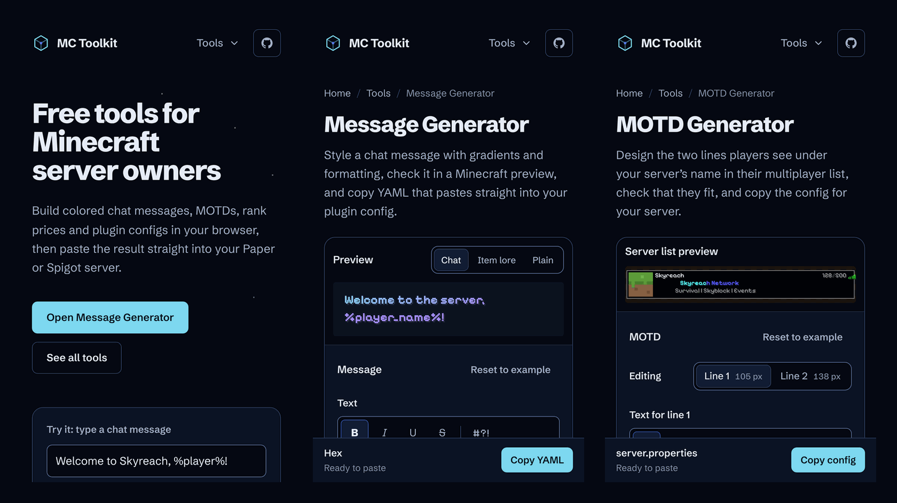

# MC Toolkit

Free, open-source tools for people who run Minecraft servers. Style chat messages and server list MOTDs in your browser, preview them the way players will see them, and copy config text that pastes straight into Paper, Spigot and popular plugins.

**Try it now: [smmezp.github.io/mc-toolkit](https://smmezp.github.io/mc-toolkit/)**

[](https://smmezp.github.io/mc-toolkit/)
[](LICENSE)



## What it is

Server owners spend a lot of time fighting color codes: gradients that break placeholders, formats a plugin doesn't understand, MOTDs that get cut off in the server list. MC Toolkit handles those details for you.

- **For** server owners, admins and plugin config editors on Paper, Spigot, vanilla and Velocity.
- **No account, nothing to install.** It's a static website that works on desktop and phone.
- **Output you can paste.** Every tool ends with a copy button and text in the exact format your config expects.

## Tools

### Message Generator

[Open the Message Generator](https://smmezp.github.io/mc-toolkit/tools/message-generator/)



- Solid colors, gradients with up to 8 colors, or rainbow, with 10 presets to start from
- Bold, italic, underline, strikethrough and obfuscated, re-applied after every color code because Minecraft resets formatting on each color
- Placeholders such as `%player_name%`, `{player}` and `<player>` get a single color, so color codes never break them
- Preview in a chat, item lore or plain background
- YAML output with nested keys (`messages.welcome`), a list for multi-line messages, and single or double quotes escaped correctly

It exports six formats, so the output matches what your plugin reads:

| Format | Looks like | Typical use |
| --- | --- | --- |
| Hex | `&#8ccfffHello` | EssentialsX, TAB, DeluxeMenus and many others (1.16+) |
| MiniMessage | `<gradient:#8ccfff:#a78bfa>` | Plugins built on Paper's Adventure API |
| Spigot hex | `&x&8&c&c&f&f&f` | Plugins using Bukkit's standard `&` translation (1.16+) |
| Legacy | `&bHello` | Any plugin and version, with the 16 classic colors |
| Section sign | `§x§8§c…` | Places that read raw formatting codes |
| CMI | `{#8ccfff}Hello` | CMI and CMILib-based plugins |

### MOTD Generator

[Open the MOTD Generator](https://smmezp.github.io/mc-toolkit/tools/motd-generator/)



- A server list preview with your server name, player count and icon
- Line widths measured with Minecraft's font: the tool warns when a line is too wide, and the preview hides the overflow where the game would
- Centering by adding measured spaces, since the server list can't center text on its own
- Separate colors and formatting for each of the two lines, with a button to copy a style to the other line
- Output for four places a MOTD can live:
  - `server.properties`: the 16 classic colors, with `§` written as `\u00A7`
  - MiniMOTD (`main.conf`): full hex gradients
  - Velocity (`velocity.toml`): full hex gradients
  - Hex lines (`&#RRGGBB`) for other MOTD plugins
- A server icon check that converts any image into a 64 × 64 `server-icon.png`, on your device

### In both tools

- The address bar always holds a link that restores your whole setup, so you can bookmark it or share it
- Reset has an undo, in case you click it by accident
- Keyboard shortcuts for formatting (Ctrl+B, Ctrl+I, Ctrl+U) and full keyboard navigation

## Screenshots

**Message Generator**



**MOTD Generator**



**On a phone**, the preview stays pinned while you edit and a copy button sits at the bottom of the screen.



## Getting started

### Use the website

1. Open a tool on [the website](https://smmezp.github.io/mc-toolkit/).
2. Type your text and choose colors and formatting. The preview updates as you type.
3. Choose the output format your plugin or config file reads. Each tool's page has a short guide if you're not sure.
4. Copy the result, paste it into your config, then reload the plugin or restart the server.

Hex colors need Minecraft 1.16 or newer on both the server and the player's game. The Legacy format works on every version.

### Run it locally

There is no build step and nothing to install. Any static file server works:

```bash
git clone https://github.com/smmezp/mc-toolkit.git
cd mc-toolkit
python3 -m http.server 8000
# then open http://localhost:8000
```

### Host your own copy

1. Fork the repository. GitHub Pages is free for public repositories.
2. In your fork, go to **Settings → Pages**, choose **Deploy from a branch**, then branch `main` and folder `/ (root)`.
3. Your copy will be online at `https://<your-username>.github.io/mc-toolkit/` within a few minutes.

All paths in the site are relative. If you use a different address, update the absolute URLs in each page's `<head>` (`canonical`, `og:url`, `og:image`), in `sitemap.xml` and in `robots.txt`.

## Privacy

There are no accounts, analytics or cookies. Your messages, MOTDs and images are processed in your browser and are never uploaded. The only outside requests are for fonts from Google Fonts.

## Roadmap

These tools are **planned and not available yet**. They're listed in the order they're expected to be built, which can change based on requests.

| Tool | Status | Purpose |
| --- | --- | --- |
| Rank Price Calculator | Planned (next) | Price VIP ranks by their perks and compare tiers |
| Crate Reward Generator | Planned | Weighted reward tables with real drop odds and config export |
| Economy Calculator | Planned | Shop prices, money supply and inflation |
| Plugin Config Helper | Planned | Config snippets for popular plugins from a simple form |
| Enchantment Planner | Planned | Custom enchantments: levels, rarity, conflicts and costs |

Have an idea or a plugin format that's missing? [Open a tool request](https://github.com/smmezp/mc-toolkit/issues/new/choose).

## Contributing

Contributions are welcome, from bug reports to new output formats.

- **Found a problem?** [Open a bug report](https://github.com/smmezp/mc-toolkit/issues/new/choose). For a wrong output format, include the plugin name, its version and your server version.
- **Want to change the code?** Fork the repository, make your change on a branch and open a pull request. Please test on a phone-sized screen and on desktop first.
- The site is plain HTML, CSS and JavaScript, with no frameworks and no build step. See [CONTRIBUTING.md](CONTRIBUTING.md) for code style and [docs/DESIGN.md](docs/DESIGN.md) for the design rules and shared components.

<details>
<summary>Project structure</summary>

```
mc-toolkit/
├── index.html                  Homepage
├── 404.html                    Not found page
├── tools/
│   ├── message-generator/      Message Generator page
│   └── motd-generator/         MOTD Generator page
├── css/
│   ├── main.css                Design tokens, base styles, shared components
│   └── tool.css                Tool workspace and form controls
├── js/
│   ├── site.js                 Header, tools menu, clipboard
│   ├── home.js                 Homepage demos
│   ├── lib/
│   │   ├── mc-text.js          Minecraft text engine: colors, gradients, formats, font widths
│   │   └── controls.js         Shared editor controls: gradient editor, format toolbar
│   └── tools/                  One script per tool
├── assets/                     Favicon, app icon, social image
├── docs/
│   ├── DESIGN.md               Design notes
│   └── images/                 README screenshots and demos
├── sitemap.xml, robots.txt
└── LICENSE, CONTRIBUTING.md
```

</details>

## License

MC Toolkit is released under the [MIT License](LICENSE). You can use, modify and host it, including commercially, as long as the license notice is kept.

If the project helps your server, a star on GitHub helps other server owners find it.

---

Not an official Minecraft product. Not approved by or associated with Mojang or Microsoft. Minecraft is a trademark of Mojang AB.
