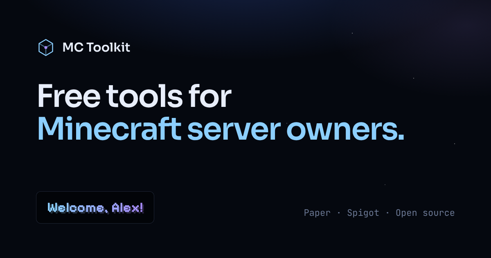

<p align="center">
  
</p>

# MC Toolkit

**Free, open-source tools for Minecraft server owners.** Generate colored messages, MOTDs, rank prices and plugin configs for Paper and Spigot — straight from your browser, with no account and nothing uploaded.

**Live site:** https://smmezp.github.io/mc-toolkit/

## Tools

| Tool | Status | What it does |
| --- | --- | --- |
| [Message Generator](https://smmezp.github.io/mc-toolkit/tools/message-generator/) | ✅ Live | Gradients, hex colors and formatting. Exports YAML in Hex (`&#RRGGBB`), MiniMessage, Spigot (`&x`), legacy, `§` and CMI formats. |
| [MOTD Generator](https://smmezp.github.io/mc-toolkit/tools/motd-generator/) | ✅ Live | Two-line server list MOTD with a live preview, width check and centering. Exports for `server.properties`, MiniMOTD, Velocity and hex lines. |
| Rank Price Calculator | 🔜 Next | Price VIP ranks by perks and audience, compare tiers. |
| Crate Reward Generator | Planned | Weighted reward tables with real drop odds and config export. |
| Economy Calculator | Planned | Shop prices, money supply and inflation modeling. |
| Plugin Config Helper | Planned | Form-based config snippets for popular plugins. |
| Enchantment Planner | Planned | Custom enchantments: levels, rarity, conflicts and costs. |

### Message Generator highlights

- Solid, multi-stop gradient (up to 8 colors) and rainbow modes
- Bold, italic, underline, strikethrough and obfuscated — re-applied after every color code, as Minecraft requires
- **Placeholder protection:** `%player_name%`, `{player}` and `<player>` are never split by color codes
- Live in-game preview (chat, item lore, plain), pinned on mobile while you edit
- Formatting toolbar with keyboard shortcuts (Ctrl+B / I / U) and a gradient bar with color stops
- YAML output with nested keys (`messages.welcome`), lists for multi-line text and correct quote escaping
- The address bar always holds a shareable link that restores the whole setup

### MOTD Generator highlights

- Server list preview with name, player count, ping and your own icon
- Width meter using Minecraft's real font metrics; wraps and hides text exactly where the client would
- Centering with measured spaces (the server list has no centering of its own)
- Per-line colors, gradients and formatting, with "use this style on the other line"
- Correct escaping for each target: `\u00A7` in `server.properties`, HOCON for MiniMOTD, TOML for Velocity
- Server icon check: converts any image to a 64 × 64 PNG, entirely on your device

## Principles

- **Static only.** HTML, CSS and vanilla JavaScript. No build step, no backend, no database, no paid APIs.
- **Real output.** Every tool produces something you can paste into a server and use.
- **Private by default.** No analytics, no cookies, no data leaves the browser.

## Project structure

```
mc-toolkit/
├── index.html                  # Homepage
├── 404.html                    # Self-contained "not found" page
├── tools/
│   ├── message-generator/
│   │   └── index.html          # Each tool lives in its own folder (clean URLs)
│   └── motd-generator/
│       └── index.html
├── css/
│   ├── main.css                # Design tokens, base styles, shared components
│   └── tool.css                # Form controls and layout for tool pages
├── js/
│   ├── site.js                 # Shared: header, clipboard, toast
│   ├── home.js                 # Homepage live example
│   ├── lib/
│   │   ├── mc-text.js          # Minecraft text engine (colors, gradients, serializers, font widths)
│   │   └── controls.js         # Shared editor controls (gradient editor, format toolbar, copy bar)
│   └── tools/
│       ├── message-generator.js
│       └── motd-generator.js
├── assets/                     # Favicon, app icon, social image
├── docs/
│   └── DESIGN.md               # Design tokens, rules and tool page anatomy
├── .claude/skills/             # Claude Code design & accessibility skills
├── .github/                    # Issue templates, funding config
├── robots.txt
├── sitemap.xml
├── .nojekyll                   # Tells GitHub Pages to serve files as-is
├── CONTRIBUTING.md
└── LICENSE
```

All paths are **relative**, so the site works both on `username.github.io/mc-toolkit/` and on a custom domain.

## Run it locally

No install needed. Any static file server works:

```bash
git clone https://github.com/smmezp/mc-toolkit.git
cd mc-toolkit
python3 -m http.server 8000
# open http://localhost:8000
```

Opening `index.html` directly from disk also works for most features.

## Publish with GitHub Pages

1. Push the code to the `main` branch of a **public** repository.
2. Go to **Settings → Pages**.
3. Under **Build and deployment**, choose **Deploy from a branch**, branch `main`, folder `/ (root)`, and save.
4. After a minute the site is live at `https://<username>.github.io/<repository>/`.

If you fork the project or use a custom domain, update the absolute URLs in the `<head>` of each page (`canonical`, `og:url`, `og:image`), in `sitemap.xml` and in `robots.txt`.

## Adding a new tool

1. Create `tools/<tool-name>/index.html` — copy the Message Generator page as a template (header, footer, SEO tags).
2. Put the tool logic in `js/tools/<tool-name>.js`. Reuse `js/lib/mc-text.js` and `js/lib/controls.js`; anything a second tool could use belongs in `js/lib/`.
3. Reuse the workspace components in `css/tool.css` (`.workspace`, `.field`, `.segmented`, `.tile`, `.code-box`…) and follow [docs/DESIGN.md](docs/DESIGN.md).
4. Turn the card on the homepage into a link, and add the URL to `sitemap.xml`.

See [CONTRIBUTING.md](CONTRIBUTING.md) for code style.

## Support the project

MC Toolkit is free and will stay free. You can help by:

- ⭐ Starring the repository — it helps other server owners find it
- 💡 [Requesting a tool or feature](https://github.com/smmezp/mc-toolkit/issues/new/choose)
- 🛠️ Contributing code, translations of plugin formats or bug reports

## License

[MIT](LICENSE) — free to use, modify and self-host.

---

NOT AN OFFICIAL MINECRAFT PRODUCT. NOT APPROVED BY OR ASSOCIATED WITH MOJANG OR MICROSOFT.
